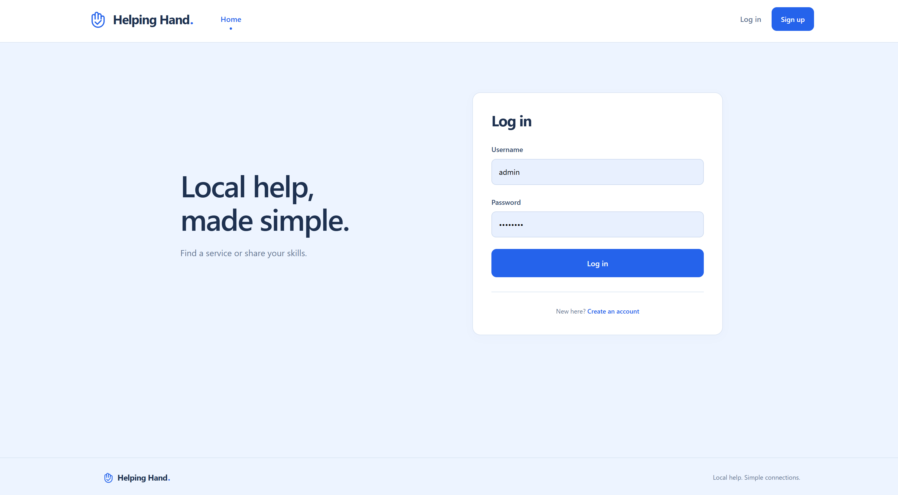
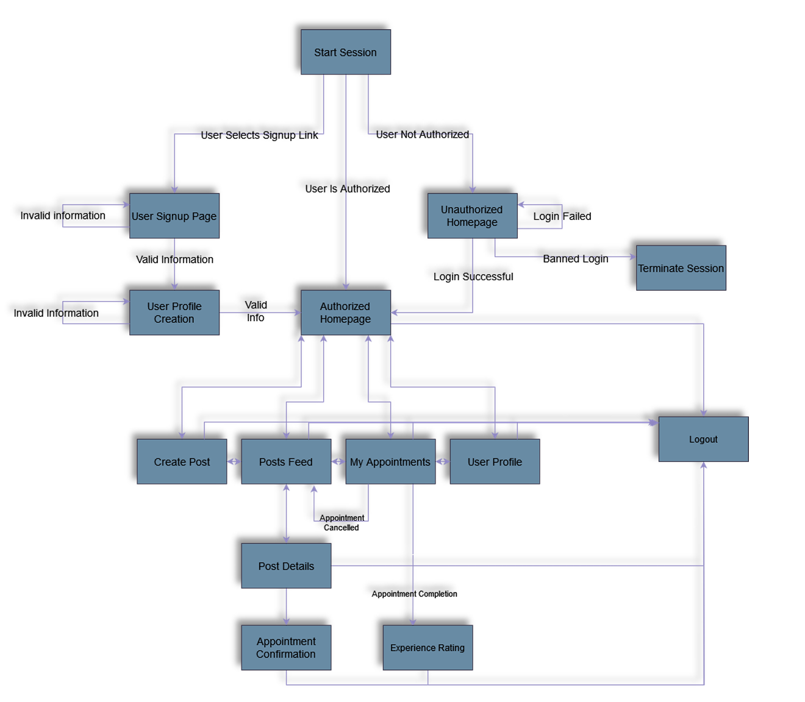
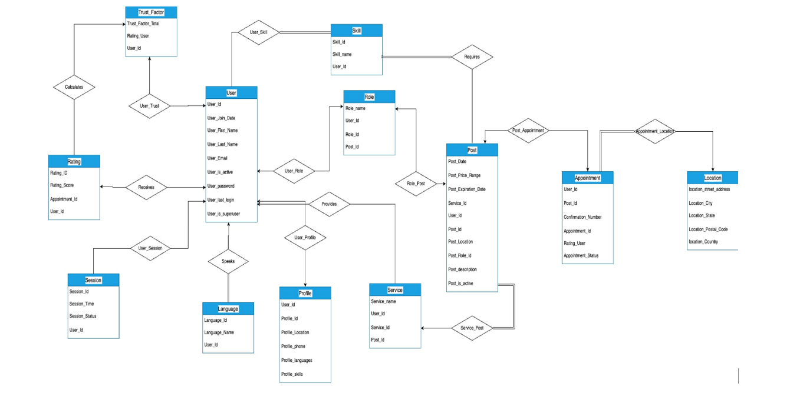

# Helping Hand

A Django app for finding local services and sharing your skills.

## Features

- Create an account and a profile with your location, skills, and languages.
- Offer or request services, browse posts, and filter by service, role, or location.
- Book, cancel, and complete appointments, then rate your experience.

Built with Python, Django, HTML, CSS, and JavaScript. SQLite is the default database.

## Setup and run

Use Python 3.11 or 3.12. Run these commands from the project directory.

On Ubuntu/Debian, install the system dependencies first:

```bash
sudo apt update
sudo apt install -y python3-venv python3-dev build-essential pkg-config default-libmysqlclient-dev
```

```bash
python3 -m venv .venv
source .venv/bin/activate
python -m pip install --upgrade pip
pip install -r requirements.txt

export DEBUG=True
python manage.py migrate
python manage.py runserver
```

Open [http://127.0.0.1:8000/](http://127.0.0.1:8000/). No database server is needed for local development.

To run again later:

```bash
source .venv/bin/activate
export DEBUG=True
python manage.py runserver
```

## Admin account (optional)

```bash
python manage.py createsuperuser
```

With the server running, visit [http://127.0.0.1:8000/admin/](http://127.0.0.1:8000/admin/).

## Tests

```bash
python manage.py test
```

## Login page



## System flow



## Entity model


